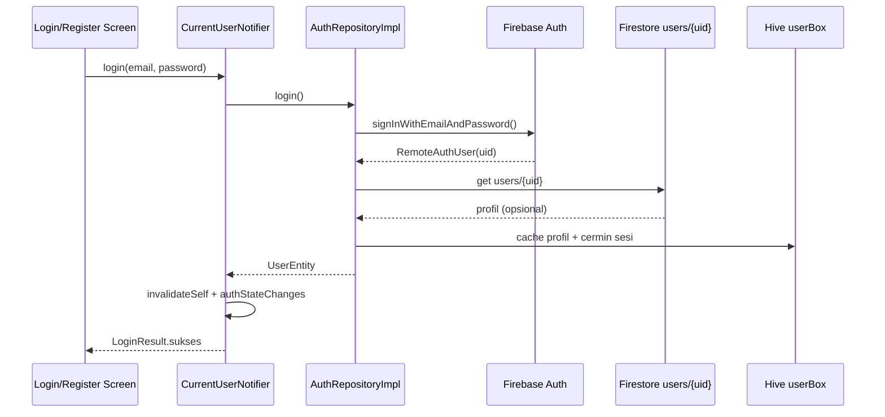

# 🔐 Auth Firebase & Kebijakan Sesi ImuniKita

- **Status**: ✅ Diimplementasikan pada Tahap 2 (B2-1 s/d B2-8)
- **Tanggal**: 13 November 2026
- **Dokumen Referensi**: `progress_context/ImuniKita_Backend_Progress_271026.md` — Tahap 2

---

## 1. Sumber Kebenaran Sesi

| Hal | Sumber kebenaran | Keterangan |
|-----|------------------|------------|
| Sesi login | **Firebase Auth** (`FirebaseAuth.currentUser` + `authStateChanges()`) | `is_logged_in`/`user_id` di SharedPreferences hanya cermin. |
| Kredensial | **Firebase Auth** | Password **tidak pernah** ditulis ke Hive/SharedPreferences. |
| Profil user | Firestore `users/{uid}` + cache Hive `userBox` | Jika Firestore tidak dapat dihubungi, cache Hive dipakai agar profil tetap terbaca offline. |
| Onboarding | SharedPreferences `seen_onboarding` | Bukan bagian autentikasi. |
| Bayi aktif | SharedPreferences `active_baby_id` | Preferensi perangkat; dibersihkan saat logout. |
| Preferensi notifikasi | SharedPreferences `notifications_enabled_<uid>` | Kunci memakai cermin `user_id`. |

Cermin `is_logged_in`, `user_id`, dan `user_name` **tetap ditulis** oleh
`AuthRepositoryImpl` karena fitur lain (mis. `BabyNotifier` dan kunci preferensi
notifikasi) masih membacanya. Nilainya tidak boleh dipakai untuk memutuskan
apakah pengguna benar-benar terautentikasi — keputusan itu selalu lewat
`FirebaseAuth.currentUser`.

## 2. Kebijakan Migrasi Akun Lokal (UTS → Firebase)

Akun fase UTS **tidak menyimpan password** (login lama hanya mencocokkan email).
Konsekuensinya:

1. **Password lama tidak dapat dimigrasikan.** Tidak ada data yang bisa
   diverifikasi atau dipindahkan ke Firebase Auth.
2. **Akun Firebase adalah akun baru.** Pengguna lama perlu mendaftar ulang
   (disarankan memakai email yang sama) agar memiliki kredensial yang aman.
3. **Data domain tetap aman.** Bayi, jadwal imunisasi, pertumbuhan, dan jurnal
   berada di Hive dan tidak dihapus saat logout/migrasi akun. Data tersebut
   diadopsi ke akun Firebase pada **Tahap 6** (sync-on-login).
4. Informasi ini ditampilkan di `LoginScreen` (banner) agar pengguna tidak
   bingung ketika akun lamanya tidak bisa dipakai masuk.

> Jangan pernah menambahkan penyimpanan password lokal (walau hanya untuk demo).
> Jika butuh mode tanpa Firebase, gunakan fallback lokal yang sudah ada —
> password tetap diabaikan, bukan disimpan.

## 3. Alur Teknis

- `AuthRemoteDatasource` adalah antarmuka kecil (fake-able) yang membungkus
  Firebase Auth + Firestore. Tipe Firebase tidak bocor ke use case.
- `AuthRepositoryImpl` menerima `AuthLocalDatasource` **dan** remote opsional.
  Remote bernilai `null` bila `FirebaseBootstrap.isInitialized == false`
  (desktop atau bootstrap gagal) → fallback lokal ala UTS.
- Penulisan profil ke Firestore bersifat **best-effort** sampai antrean outbox
  Tahap 5 tersedia: profil selalu tersimpan di Hive lebih dulu.
- Mengubah **email** lewat form profil saat ini hanya memperbarui dokumen
  `users/{uid}`. Email kredensial di Firebase Auth belum ikut diubah karena
  `updateEmail` memerlukan autentikasi ulang + verifikasi; sinkronisasi ini
  dicatat sebagai tindak lanjut (bukan bagian Tahap 2).

## 4. Pemetaan Error Firebase Auth

| Kode Firebase | Failure | Pesan UI |
|---------------|---------|----------|
| `email-already-in-use` | `EmailAlreadyInUseFailure` | Email ini sudah terdaftar. Silakan masuk. |
| `weak-password` | `WeakPasswordFailure` | Password terlalu lemah. Gunakan minimal 6 karakter. |
| `user-not-found` | `UserNotFoundFailure` | Email belum terdaftar. Silakan daftar terlebih dahulu. |
| `wrong-password`, `invalid-credential` | `InvalidCredentialsFailure` | Email atau password salah. Periksa kembali. |
| `invalid-email` | `AuthFailure` | Format email tidak valid. |
| `user-disabled` | `AuthFailure` | Akun ini dinonaktifkan. |
| `too-many-requests` | `AuthFailure` | Terlalu banyak percobaan. Tunggu sebentar. |
| `network-request-failed` | `NetworkFailure` | Tidak ada koneksi internet. |
| `operation-not-allowed` | `AuthFailure` | Metode email/password belum diaktifkan. |

Pemetaan ada di `lib/features/auth/data/repositories/auth_repository_impl.dart`
(`authFailureFromCode`) dan diuji tanpa jaringan di
`test/auth_firebase_test.dart`.

## 5. Pengujian

- **Unit**: `AuthRepositoryImpl` diuji dengan fake `AuthRemoteDatasource` +
  Hive sementara → tidak ada panggilan Firebase.
- **Widget**: login/register memakai fake `IAuthRepository` melalui
  `ProviderScope(overrides: ...)`.
- **Manual (emulator/device)**: jalankan
  `flutter run --dart-define=USE_EMULATOR=true` lalu uji daftar, masuk, salah
  password, lupa password, dan logout. Emulator Auth berjalan di port `9099`,
  Firestore di `8080`.
