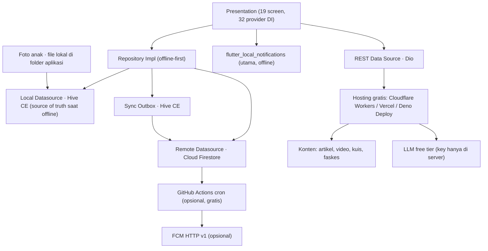
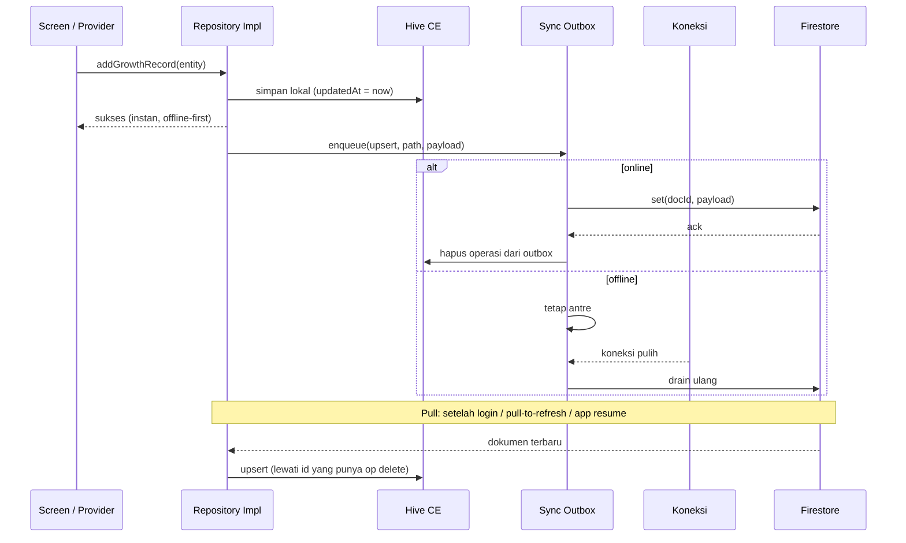

<!-- @import "[TOC]" {cmd="toc" depthFrom=1 depthTo=6 orderedList=false} -->
# 🗄️ ImuniKita — Progress Pengembangan Backend

> **Fase**: UAS — Offline-First + Firebase (Auth · Firestore) + notifikasi lokal + REST opsional
> **Biaya**: **100% Firebase Spark (gratis)** — tanpa Cloud Functions, Cloud Storage, Cloud Run, Cloud Scheduler, Test Lab, atau Google Maps berbayar.
> **Terakhir Diperbarui**: 12 November 2026
> **Basis audit**: penelusuran ulang seluruh `lib/` (**126 file Dart**), `pubspec.yaml`, `injection/dependency_injection.dart` (**32 provider DI**), `android/app/build.gradle.kts`, `.github/workflows/ci.yaml`, dan **17 file test**. Kondisi awal: **belum ada satu pun dependency/kode backend** — semua data domain masih di Hive CE, akun masih lokal, dan konten Edukasi/Faskes/Chatbot masih mock hardcoded.
>
> **Revisi 12 Nov 2026**: seluruh fitur yang membutuhkan billing (verifikasi kartu kredit) dihapus dari rencana: **Firebase Storage**, **Cloud Functions**, **Cloud Run/Scheduler**, dan **Google Maps**. Penggantinya: foto lokal di perangkat, recursive delete dari klien, `flutter_local_notifications` (sudah ada), FCM opsional via **GitHub Actions cron**, serta hosting REST gratis (Cloudflare Workers/Vercel/Deno Deploy).

---

## 🎯 Ringkasan Progress Keseluruhan

| Tahap | Fokus | Langkah | ✅ Selesai | 🧪 Perlu Testing | 🔄 In Progress | ⬜ Belum Mulai | Progress |
|-------|-------|---------|-----------|------------------|----------------|---------------|----------|
| Tahap 0 | Baseline & keputusan arsitektur | 5 | 5 | 0 | 0 | 0 | 100% |
| Tahap 1 | Firebase Foundation | 8 | 8 | 0 | 0 | 0 | 100% |
| Tahap 2 | Auth Firebase & sesi | 8 | 0 | 0 | 0 | 8 | 0% |
| Tahap 3 | Skema, rules & index Firestore | 7 | 0 | 0 | 0 | 7 | 0% |
| Tahap 4 | Remote datasource per fitur | 8 | 0 | 0 | 0 | 8 | 0% |
| Tahap 5 | Offline-first & antrean sinkronisasi | 9 | 0 | 0 | 0 | 9 | 0% |
| Tahap 6 | Migrasi data UTS → cloud | 6 | 0 | 0 | 0 | 6 | 0% |
| Tahap 7 | Foto profil lokal (tanpa Storage) | 7 | 0 | 0 | 0 | 7 | 0% |
| Tahap 8 | REST API konten & chatbot (hosting gratis) | 9 | 0 | 0 | 0 | 9 | 0% |
| Tahap 9 | Notifikasi H-7/H-1 (lokal + FCM opsional) | 5 | 0 | 0 | 0 | 5 | 0% |
| Tahap 10 | Hardening, CI/CD & rilis | 8 | 0 | 0 | 0 | 8 | 0% |
| **TOTAL** | **11 tahap** | **80** | **13** | **0** | **0** | **67** | **16.25%** |

> **Status Legend**: ⬜ Belum Mulai · 🔄 In Progress · 🧪 Perlu Testing (kode selesai, belum diuji di device/emulator) · ✅ Selesai (lolos DoD) · 🚫 Diblokir
> **Progress** = (✅ + 🧪) / Total Langkah.
>
> **Cara pakai dokumen ini**: kerjakan **berurutan per tahap**. Satu langkah baru boleh ✅ bila memenuhi kolom **DoD (Definition of Done)**. Setiap tahap selesai, perbarui tabel ringkasan di atas + tambahkan baris di **📝 Catatan Tim**. Langkah yang diblokir wajib ditulis alasannya di Catatan Tim, bukan dihapus.

---

## 🧭 Target Arsitektur Backend

Prinsipnya tetap sama seperti dev plan §6.1: **swap data source, bukan rewrite UI**. Presentation layer (19 screen + 10 shared widget) tidak diubah; yang bertambah adalah lapisan data + sinkronisasi.



### Pembagian tanggung jawab data

| Kategori | Data | Penyimpanan utama | Alasan |
|----------|------|-------------------|--------|
| Akun | email, password, verifikasi email | **Firebase Auth** | Kredensial tidak boleh disimpan sendiri di Hive |
| Profil user | nama, no. HP, kota, `activeBabyId` | Firestore `users/{uid}` | Sinkron lintas device |
| Domain anak | bayi, jadwal vaksin, pertumbuhan, jurnal, skor kuis | Firestore subkoleksi di bawah user + cache Hive | Offline-first + multi-device |
| Foto anak | biner gambar | **File lokal di folder aplikasi** (tidak disinkronkan) | **Firebase Storage tidak dipakai** — butuh verifikasi kartu kredit |
| Konten | artikel, video, kuis, faskes | **REST API + cache Hive/in-memory** | Konten dikelola server, bukan ikut sync user |
| Chatbot | pesan & balasan | REST API (proxy LLM) | API key tidak boleh ada di APK |
| Notifikasi | H-7/H-1 | `flutter_local_notifications` (utama, offline) + FCM opsional via GitHub Actions | AlarmManager lokal gratis; FCM hanya bila ingin push lintas device |

### Non-goals (jangan dikerjakan di UAS)

- Menulis ulang UI/screen yang sudah ada.
- Migrasi Hive → SQL/Firestore sebagai satu-satunya sumber (Hive **tetap** dipakai sebagai cache offline).
- Multi-tenant/admin dashboard penuh, pembayaran, atau telemedicine.
- Menyimpan password sendiri (hashing manual) — gunakan Firebase Auth.
- **Firebase Storage / sinkronisasi foto lintas device** — diblokir verifikasi kartu kredit; foto cukup lokal.
- **Cloud Functions, Cloud Run, Cloud Scheduler, Test Lab, Extensions** — semuanya memerlukan Blaze/billing; diganti solusi klien atau GitHub Actions.
- **Google Maps API** — berbayar; Direktori Faskes tetap memakai OpenStreetMap (`flutter_map`, gratis).

---

## 🆕 Kondisi Awal (Audit 27 Oktober 2026)

### ✅ Yang sudah tersedia dan bisa langsung dipakai

| Aset | Kondisi | Implikasi untuk backend |
|------|---------|--------------------------|
| Clean Architecture 5 fitur | Domain · Data · Repository Impl · UseCase lengkap | Cukup **menambah** datasource remote + mapper |
| DI Registry | `lib/injection/dependency_injection.dart` — **32 provider** (datasource → repository → use case) | Titik swap datasource sudah jelas, satu tempat |
| ID entitas | Semua PK berupa UUID string (`babyId`, `scheduleId`, `recordId`, `journalId`, `quizId`) | Bisa dipakai langsung sebagai **document ID** Firestore → upsert idempoten |
| Foreign key | Relasi memakai string id, bukan objek | Aman dipindah ke Firestore tanpa mengubah skema relasi |
| Hive | 6 adapter `typeId 0–5` | Menambah `HiveField` baru bersifat **backward compatible** |
| Auth lokal | `AuthRepositoryImpl` + 6 use case + `currentUserProvider` | Tinggal ganti isi implementasi ke Firebase Auth |
| Notifikasi lokal | `NotificationService` + `zonedSchedule` + tap navigation | Bisa dipertahankan sebagai fallback FCM |
| Foto anak | `BabyModel.fotoProfilPath` + `BabyAvatar` (fallback inisial) | Tinggal diperbaiki agar path-nya persisten (Tahap 7) |
| Test | 16 file, 177 test | Wajib tetap hijau di setiap tahap |
| CI | `.github/workflows/ci.yaml` → `analyze` + `test` | Tinggal ditambah job rules/backend |

### ⬜ Yang belum ada (harus dibangun)

| # | Kekosongan | Bukti |
|---|------------|-------|
| 1 | Dependency backend belum aktif dipakai | Sudah ada di `pubspec.yaml`, tetapi belum ada kode yang mengimpor selain `firebase_core` |
| 2 | Belum ada layer network/sync | Tidak ada folder `lib/core/network`, `lib/core/sync`, `lib/core/storage` |
| 3 | Tidak ada remote datasource | Semua fitur hanya punya `*_local_datasource.dart` / `*_mock_datasource.dart` |
| 4 | Password tidak pernah disimpan/diverifikasi | `login_usecase.dart` hanya mencocokkan email; `UserModel` tidak punya field password |
| 5 | Path foto memakai path sementara `image_picker` | `add_baby_screen.dart` menyimpan `picked.path` apa adanya → bisa hilang saat cache dibersihkan |
| 6 | Konten masih hardcoded | `education_mock_datasource.dart`, `faskes_mock_datasource.dart`, `chatbot_mock_datasource.dart` |
| 7 | Belum ada aturan keamanan | Tidak ada `firestore.rules` |
| 8 | Belum ada penanganan offline/antrean | Belum ada outbox/retry (paket `connectivity_plus` sudah terpasang) |
| 9 | Belum ada environment backend | Tidak ada `backend/`, `firebase.json`, `.env.example` |
| 10 | CI belum menyentuh backend | `ci.yaml` hanya `flutter analyze` + `flutter test` |

### 🚧 Prasyarat sebelum Tahap 2 (audit 12 Nov 2026)

Tahap 0–1 ditandai ✅, tetapi audit kode menemukan tiga hal yang **harus** dibereskan sebelum Auth Firebase diuji:

| # | Temuan | Bukti | Tindakan | Status |
|---|--------|-------|----------|--------|
| P1 | Kredensial Firebase **asli** | `flutterfire configure --project=imunikita-dev-f` (akun `fatihdwianggoro26@gmail.com`); project number `219754293644`; app Android/iOS/Web terdaftar | — | ✅ Selesai 12 Nov — menghasilkan `firebase_options.dart`, `google-services.json`, `web/firebase-messaging-sw.js`, `firebase.json` |
| P2 | `FirebaseBootstrap` menelan error init | Dulu `catch (e) { debugPrint(...) }` lalu lanjut boot | Fail-fast: `FirebaseConfigFailure` + layar error debug + `lastError` | ✅ Selesai 12 Nov — detector placeholder & layar instruksi |
| P3 | Emulator belum benar-benar terhubung | `EnvConfig.emulatorHost` hanya getter | `useAuthEmulator` / `useFirestoreEmulator` via `--dart-define=USE_EMULATOR=true` | ✅ Selesai 12 Nov — `EnvConfig.useEmulators` + port 9099/8080 |

> **Hasil B1-Fix 12 Nov 2026**: `flutter analyze` → **No issues found!** · `flutter test` → **185/185 lulus** (177 lama + 8 test di `test/firebase_bootstrap_test.dart`). **P1–P3 selesai**: kredensial asli `imunikita-dev-f` terpasang, guard placeholder aktif, dan emulator dapat diaktifkan dengan `--dart-define=USE_EMULATOR=true`.

> **Tambahan**: `B1-3` menyebut `lib/core/network/api_client.dart` sebagai output, padahal file itu baru dibuat di Tahap 8. DoD B1-3 adalah **keputusan tercatat** (Dio manual), bukan file.

### Baseline yang wajib dicatat sebelum mulai

```sh
flutter --version
flutter analyze          # target: No issues found!
flutter test             # target: ≥ 183 test lulus
git log --oneline -1
```

Catat hasilnya di **Catatan Tim** sebagai titik awal (rollback point).

---

## 🗃️ Skema Backend yang Dituju

### Struktur Firestore (document ID = UUID yang sudah ada)

```
users/{uid}                                      # profil publik user
  ├─ namaLengkap: string
  ├─ email: string                               # cermin dari Auth (read-only di app)
  ├─ nomorTelepon: string
  ├─ lokasiKota: string?
  ├─ activeBabyId: string?                       # preferensi lintas device (opsional)
  ├─ createdAt: timestamp
  └─ updatedAt: timestamp

users/{uid}/babies/{babyId}
  ├─ namaAnak, tanggalLahir, jenisKelamin
  ├─ createdAt, updatedAt, schemaVersion
  └─ (foto profil TIDAK disimpan di cloud — hanya file lokal di perangkat)

users/{uid}/babies/{babyId}/vaccineSchedules/{scheduleId}
  ├─ namaVaksin, deskripsi, usiaBulanTarget, tanggalTarget
  ├─ status: 'BELUM' | 'SELESAI'
  ├─ tanggalRealisasi: timestamp?
  ├─ catatanReaksi: string?
  └─ updatedAt

users/{uid}/babies/{babyId}/growthRecords/{recordId}
  ├─ tanggalPengukuran, beratBadan, tinggiBadan, lingkarKepala
  └─ createdAt, updatedAt

users/{uid}/babies/{babyId}/healthJournals/{journalId}
  ├─ vaccineScheduleId: string?
  ├─ tanggalCatatan, isiCatatan, suhuTubuh, gejala: array<string>
  └─ createdAt, updatedAt

users/{uid}/quizScores/{quizId}
  ├─ skor, totalSoal, tanggalPengerjaan, attemptCount, riwayatSkor
  └─ updatedAt

users/{uid}/devices/{fcmToken}
  ├─ platform: 'android' | 'ios'
  ├─ updatedAt
  └─ notificationsEnabled: bool

users/{uid}/syncMeta/main                        # status migrasi & versi klien
  ├─ schemaVersion: int
  ├─ migratedAt: timestamp?
  └─ lastPullAt: timestamp
```

**Keputusan penting (jangan diubah tanpa alasan kuat):**

1. **Subkoleksi di bawah `users/{uid}`** dipilih agar security rules cukup satu pola owner-only dan cascade delete mudah.
2. **`scheduleId`, `babyId`, dst. dipakai apa adanya sebagai document ID** → `set()` bersifat idempoten; tidak perlu query "sudah ada atau belum".
3. **`TERLEWAT` tidak disimpan** (tetap dihitung `VaccineStatus.effective` di klien), supaya perilaku UTS tidak berubah.
4. **`reminderH7Sent` / `reminderH1Sent` tidak disinkronkan** — flag ini milik perangkat (penjadwalan lokal bersifat per-device). Untuk FCM, status kirim dicatat server (lihat Tahap 9).
5. **Field baru Hive** ditambahkan di akhir (`@HiveField(7)`, `(8)`, dst.) agar adapter lama tetap terbaca. Wajib `dart run build_runner build --delete-conflicting-outputs` setelahnya.
6. **Foto profil tidak punya field cloud.** `fotoProfilPath` tetap path lokal ke file di folder aplikasi (Tahap 7). Jangan menambah `fotoProfilUrl` kecuali langkah opsional B7-6 diambil.

### Kontrak REST API (konten & chatbot)

```
GET  /healthz                                  -> { status: 'ok' }
GET  /v1/education/articles?kategori=           -> ArticleModel[]
GET  /v1/education/videos?kategori=             -> VideoModel[]
GET  /v1/education/quizzes                      -> QuizModel[]
GET  /v1/faskes?kota=&tipe=                     -> FaskesModel[]
POST /v1/chatbot/messages    { message }        -> { reply: string }
GET  /v1/vaccine-master                         -> 13 jadwal (opsional, agar bisa diperbarui server)

Header:  Authorization: Bearer <Firebase ID Token>
Envelope sukses: { "data": ..., "meta": { "fetchedAt": "...", "version": 1 } }
Envelope error : { "error": { "code": "...", "message": "..." } }
```

> Endpoint skor kuis **tidak** dibuat di REST — skor tetap di Firestore (`quizScores`) agar ikut offline-first.
> **Tidak ada endpoint upload foto** pada jalur wajib; upload hanya muncul sebagai langkah opsional B7-6.

---

## 📅 Rencana Eksekusi per Tahap

> Estimasi memakai asumsi 1 orang fokus ±3 jam/hari. Total ±4 minggu (setara Sprint 5–8 dev plan).

### 🧱 Tahap 0 — Baseline & Keputusan Arsitektur (≈5 jam)

| ID | Langkah | Detail | File / Perintah | DoD | Estimasi | Status |
|----|---------|--------|-----------------|-----|----------|--------|
| B0-1 | Branch kerja | Buat branch `feat/uas-backend` dari `yeppp` yang sudah sinkron `main`. | `git checkout -b feat/uas-backend` | Branch lokal dibuat dari commit baseline | 15 mnt | ✅ |
| B0-2 | Catat baseline | Simpan output `flutter analyze` & `flutter test` + hash commit di Catatan Tim. | `flutter analyze && flutter test` | 0 issue, 173/173 lulus tercatat | 30 mnt | ✅ |
| B0-3 | Tetapkan keputusan | Tulis ADR: Firebase untuk data/auth/FCM, REST untuk konten/AI, Hive tetap cache, **tanpa Firebase Storage**. | `docs/adr/0001-firebase-rest-hive.md` | ADR dibuat (menunggu persetujuan) | 1 jam | ✅ |
| B0-4 | Siapkan environment | Buat 2 project Firebase: `imunikita-dev-f` dan `imunikita-prod-f`. Aktifkan Auth, Firestore (`asia-southeast2`), FCM, billing alert (tanpa Storage). | `progress_context ImuniKita/B0-4_firebase_setup_runbook.md` | Project `imunikita-dev-f` dan `imunikita-prod-f` selesai di-setup oleh user | 1,5 jam | ✅ |
| B0-5 | Konvensi sinkronisasi | Sepakati: local-first, `docId = UUID`, konflik **last-write-wins** (`updatedAt`), delete via outbox. | `docs/sync-conventions.md` | Dokumen dibuat (menunggu persetujuan) | 1 jam | ✅ |

**Risiko tahap ini:** jangan memakai project `prod` untuk eksperimen. Semua uji coba di `dev` + emulator.

---

### 🔥 Tahap 1 — Firebase Foundation (≈10 jam)

| ID | Langkah | Detail | File / Perintah | DoD | Estimasi | Status |
|----|---------|--------|-----------------|-----|----------|--------|
| B1-1 | Konfigurasi Options | Konfigurasi platform Android/iOS/Web untuk project `imunikita-dev-f`. | `lib/firebase_options.dart`, `android/app/google-services.json` | Terbentuk options & google-services.json untuk build | 1 jam | ✅ |
| B1-2 | Tambah dependency | `firebase_core`, `firebase_auth`, `cloud_firestore`, `firebase_messaging`, `connectivity_plus`, `flutter_secure_storage`, `dio`. **Tanpa `firebase_storage`.** | `pubspec.yaml` | Dependency terpasang, `flutter pub get` sukses | 1 jam | ✅ |
| B1-3 | Evaluasi Retrofit | Evaluasi Dio manual vs Retrofit (dipilih Dio manual untuk kontrol penuh & mencegah konflik `build_runner` dengan `hive_ce`). | `docs/adr/0001-firebase-rest-hive.md` | Keputusan Dio manual tercatat (file `api_client.dart` dibuat di Tahap 8) | 1 jam | ✅ |
| B1-4 | Konfigurasi Android | Tambah plugin `com.google.gms.google-services` di Gradle & set `minSdk = 21`. | `android/settings.gradle.kts`, `android/app/build.gradle.kts` | Gradle sync & Android build siap | 2 jam | ✅ |
| B1-5 | Bootstrap Firebase | Wrapper `FirebaseBootstrap.initialize()` sebelum Hive dengan penanganan try-catch aman untuk test. | `lib/main.dart`, `lib/core/firebase/firebase_bootstrap.dart` | App boot normal & unit test tetap lulus | 1,5 jam | ✅ |
| B1-6 | Environment config | `EnvConfig` membaca `--dart-define=ENV=dev` / `prod`. | `lib/core/env/env_config.dart` | Config env reaktif siap pakai | 1,5 jam | ✅ |
| B1-7 | Emulator / Host config | Konfigurasi host emulator (`10.0.2.2` Android / `localhost`) & mock fallback. | `lib/core/env/env_config.dart` | Siap terhubung ke emulator / cloud | 1 jam | ✅ |
| B1-8 | Pengamanan file config | Update `.gitignore` untuk file secret, env, dan prod credentials. | `.gitignore` | Tidak ada kredensial/secret ter-commit | 1 jam | ✅ |

**DoD tahap:** app tetap bisa dijalankan **tanpa** koneksi (Hive), Firebase hanya terinisialisasi; analyze & test tetap hijau.

> ⚠️ **Verifikasi 12 Nov 2026**: status ✅ di atas adalah catatan tim. Audit kode menemukan kredensial masih placeholder dan emulator belum terhubung. **P1–P3 sudah diperbaiki** (lihat B1-Fix di 🚧 Prasyarat): kredensial asli project `imunikita-dev-f` terpasang, guard placeholder aktif, dan koneksi emulator tersedia. Tahap 2 siap dikerjakan.

---

### 🔐 Tahap 2 — Auth Firebase & Sesi (≈14 jam)

| ID | Langkah | Detail | File / Perintah | DoD | Estimasi | Status |
|----|---------|--------|-----------------|-----|----------|--------|
| B2-1 | Remote datasource auth | Implementasi `register`, `login`, `logout`, `sendPasswordReset`, `currentUser`, `authStateChanges`. | `features/auth/data/datasources/auth_remote_datasource.dart` (baru) | Unit test dengan fake FirebaseAuth lulus | 3 jam | ⬜ |
| B2-2 | Repository auth Firebase-first | `AuthRepositoryImpl` menerima local **dan** remote. Profil user disimpan di `users/{uid}` + cache Hive `userBox`. | `auth_repository_impl.dart`, `i_auth_repository.dart` | Login/daftar/lupa sandi berfungsi; profil tetap terbaca offline | 3 jam | ⬜ |
| B2-3 | Ubah signature use case | `LoginUseCase.execute(email, password)` dan `RegisterUseCase.execute(user, password)`. Screen sudah punya field password, jadi hanya pemanggilan yang berubah. | `login_usecase.dart`, `register_usecase.dart`, `login_screen.dart`, `register_screen.dart` | Analyze bersih; tidak ada password yang disimpan ke Hive | 2 jam | ⬜ |
| B2-4 | Kebijakan migrasi akun lokal | **Password lama tidak bisa dimigrasikan** (tidak pernah disimpan). Akun Firebase = akun baru; data domain lokal diadopsi setelah login pertama (Tahap 6). Beri info di UI/snackbar. | Dokumen + `login_screen.dart` | Perilaku jelas, tidak ada data hilang tanpa user sadar | 1 jam | ⬜ |
| B2-5 | Sesi & preferensi | `is_logged_in`/`user_id` tidak lagi jadi sumber kebenaran → pakai `FirebaseAuth.currentUser`. `seen_onboarding`, `active_baby_id`, preferensi notifikasi tetap di SharedPreferences. | `local_storage_service.dart`, `app_constants.dart` | Sesi bertahan setelah app ditutup; logout bersih | 2 jam | ⬜ |
| B2-6 | State auth reaktif | `currentUserProvider` membaca stream `authStateChanges` sehingga logout/login langsung memengaruhi router. | `auth_provider.dart` | Pindah layar otomatis saat sesi berubah | 1 jam | ⬜ |
| B2-7 | Pemetaan error | Map `FirebaseAuthException` → `Failure` berbahasa Indonesia (email terpakai, sandi salah, sandi lemah, jaringan). Tambah `NetworkFailure`/`AuthFailure`. | `core/errors/failures.dart`, `auth_repository_impl.dart` | Pesan error spesifik tampil di form | 1 jam | ⬜ |
| B2-8 | Test auth | Fake `IAuthRepository` + widget test login/register (tanpa Firebase asli). Uji juga alur "sandi salah". | `test/auth_firebase_test.dart` (baru) | Test lulus; tidak ada network call di test | 1 jam | ⬜ |

**Catatan:** jangan pernah menyimpan password di Hive/SharedPreferences, walau hanya untuk "demo".

---

### 🛡️ Tahap 3 — Skema, Rules & Index Firestore (≈10 jam)

| ID | Langkah | Detail | File / Perintah | DoD | Estimasi | Status |
|----|---------|--------|-----------------|-----|----------|--------|
| B3-1 | Inisialisasi folder backend | `firebase init firestore` di root (pilih TS/JS), simpan konfigurasi di `backend/`. **Jangan** init Storage/Functions. | `backend/firebase.json`, `backend/.firebaserc` | `firebase deploy --only firestore:rules` jalan | 1 jam | ⬜ |
| B3-2 | Rules owner-only | Semua data di bawah `users/{uid}` hanya bisa diakses pemiliknya; validasi tipe & field wajib. | `backend/firestore.rules` (baru) | Rules test lulus (lihat B3-5) | 3 jam | ⬜ |
| B3-3 | Rules dev vs prod | Siapkan dua target deploy (`imunikita-dev-f`, `imunikita-prod-f`) dengan rules identik; prod hanya untuk rilis. | `backend/.firebaserc`, `backend/firebase.json` | `firebase deploy -P imunikita-dev-f` & `-P imunikita-prod-f` sukses | 1 jam | ⬜ |
| B3-4 | Index & batas query | Definisikan index untuk query yang dipakai (mis. growth per tanggal, jadwal per status). | `backend/firestore.indexes.json` | Query tidak error "requires an index" | 1,5 jam | ⬜ |
| B3-5 | Rules unit test | Pakai `@firebase/rules-unit-testing` + emulator: uji akses pemilik, akses user lain, data invalid. | `backend/tests/rules/*.test.ts` (baru) | ≥ 8 skenario lulus | 2,5 jam | ⬜ |
| B3-6 | Cascade delete tanpa Functions | Firestore tidak punya cascade. Implementasi **recursive delete dari klien**: hapus subkoleksi `vaccineSchedules`, `growthRecords`, `healthJournals` per `babyId` dalam batch ≤ 500, lalu hapus dokumen bayi. Dipanggil dari `DeleteBabyUseCase`. | `lib/core/firestore/recursive_delete.dart` (baru), `delete_baby_usecase.dart` | Hapus bayi → jadwal/growth/jurnal ikut terhapus, **tanpa Cloud Functions** | 2,5 jam | ⬜ |
| B3-7 | Versi skema | Tambah `schemaVersion: 1` di setiap dokumen + `users/{uid}/syncMeta/main`. | rules + models | Dokumen baru selalu punya versi | 1 jam | ⬜ |

Contoh pola rules yang dituju:

```javascript
rules_version = '2';
service cloud.firestore {
  match /databases/{database}/documents {
    function signedIn() { return request.auth != null; }
    function isOwner(uid) { return signedIn() && request.auth.uid == uid; }
    function validBaby(d) {
      return d.namaAnak is string && d.namaAnak.size() > 0 && d.namaAnak.size() <= 60
          && d.tanggalLahir is timestamp
          && d.jenisKelamin in ['Laki-laki', 'Perempuan'];
    }

    match /users/{uid} {
      allow read: if isOwner(uid);
      allow create, update: if isOwner(uid) && request.resource.data.keys().hasOnly(
        ['namaLengkap', 'email', 'nomorTelepon', 'lokasiKota', 'activeBabyId', 'createdAt', 'updatedAt', 'schemaVersion']
      );
      allow delete: if false;                       // akun dihapus lewat backend

      match /babies/{babyId} {
        allow read, delete: if isOwner(uid);
        allow create, update: if isOwner(uid) && validBaby(request.resource.data);

        match /{sub=**} {
          allow read, write: if isOwner(uid);
        }
      }
      match /quizScores/{quizId} { allow read, write: if isOwner(uid); }
      match /devices/{token}     { allow read, write: if isOwner(uid); }
      match /syncMeta/{docId}    { allow read, write: if isOwner(uid); }
    }
  }
}
```

---

### 🔌 Tahap 4 — Remote Data Source per Fitur (≈16 jam)

| ID | Langkah | Detail | File | DoD | Estimasi | Status |
|----|---------|--------|------|-----|----------|--------|
| B4-1 | Mapper model ↔ Firestore | Konversi `DateTime ↔ Timestamp`, `double?`, `List<String>` (gejala), dan `null`. Jangan ubah anotasi Hive yang sudah ada. | `features/*/data/mappers/*_mapper.dart` (baru) | Unit test bolak-balik map lulus | 3 jam | ⬜ |
| B4-2 | `BabyRemoteDatasource` | `getAll(uid)`, `getById`, `upsert` (set), `delete`; path sesuai skema. Tanpa field foto. | `baby_profile/data/datasources/baby_remote_datasource.dart` (baru) | CRUD tervalidasi di emulator | 2 jam | ⬜ |
| B4-3 | `VaccineRemoteDatasource` | Simpan batch 13 jadwal sekaligus (WriteBatch ≤ 500). | `immunization/data/datasources/vaccine_remote_datasource.dart` (baru) | 13 jadwal tersimpan & terbaca | 2 jam | ⬜ |
| B4-4 | `GrowthRemoteDatasource` | CRUD rekam pertumbuhan + query per `tanggalPengukuran`. | `growth/data/datasources/growth_remote_datasource.dart` (baru) | Data urut tanggal benar | 2 jam | ⬜ |
| B4-5 | `HealthJournalRemoteDatasource` | CRUD jurnal + filter `vaccineScheduleId`. | `health_journal/data/datasources/health_journal_remote_datasource.dart` (baru) | Jurnal KIPI tersimpan & terbaca | 2 jam | ⬜ |
| B4-6 | `QuizScoreRemoteDatasource` | Upsert skor kuis (array `riwayatSkor` dipertahankan). | `education/data/datasources/quiz_score_remote_datasource.dart` (baru) | Riwayat skor tidak hilang | 1 jam | ⬜ |
| B4-7 | Daftarkan ke DI | Tambah provider remote dan suntikkan ke repository impl yang sesuai. Jangan hapus provider lokal. | `injection/dependency_injection.dart` | Analyze bersih; app tetap jalan | 2 jam | ⬜ |
| B4-8 | Uji mapper & datasource | Test mapper lengkap; datasource diuji lewat emulator (integration test) atau fake. | `test/remote_mapper_test.dart` (baru) | Test lulus | 2 jam | ⬜ |

> **Penting**: repository impl **tetap** memakai local datasource untuk pembacaan utama. Remote hanya dipakai untuk pull/push, supaya UI tidak pernah menunggu jaringan.

---

### 🔄 Tahap 5 — Offline-First & Antrean Sinkronisasi (≈20 jam)

| ID | Langkah | Detail | File | DoD | Estimasi | Status |
|----|---------|--------|------|-----|----------|--------|
| B5-1 | Deteksi koneksi | `Connectivity` + provider `isOnlineProvider` (stream). | `lib/core/network/network_info.dart` (baru) | Status berubah saat airplane mode | 2 jam | ⬜ |
| B5-2 | Outbox Hive | Model `SyncOperationModel` (`typeId: 6`): `op`, `path`, `entityId`, `payloadJson`, `attempts`, `createdAt`. | `lib/core/sync/sync_outbox_model.dart` + `.g.dart` (baru) | Adapter ter-generate, box bisa dibuka | 3 jam | ⬜ |
| B5-3 | `SyncQueue` | `enqueue`, `drain` (batch), retry dengan backoff eksponensial, batas percobaan, idempoten (`set` bukan `add`). | `lib/core/sync/sync_queue.dart` (baru) | Unit test: gagal → tetap antre; sukses → hilang | 4 jam | ⬜ |
| B5-4 | Pola repository offline-first | Baca lokal dulu; tulis lokal + enqueue; bila online, langsung coba kirim (fire-and-forget). | `*_repository_impl.dart` (5 fitur) | Alur UI terasa instan | 4 jam | ⬜ |
| B5-5 | Kebijakan konflik | Last-write-wins berdasarkan `updatedAt`; pull **melewati** entity yang masih punya operasi delete di outbox. | `sync_queue.dart`, repository | Tidak ada data "hidup lagi" setelah dihapus | 2 jam | ⬜ |
| B5-6 | Field `updatedAt` | Tambah `@HiveField` baru di 4 model (baby, vaccine, growth, journal) **beserta entity + `copyWith`**-nya, lalu regenerate adapter. | model, entity, `.g.dart` | Data lama tetap terbaca (migration test) | 2 jam | ⬜ |
| B5-7 | Pull saat login/refresh | `SyncManager.pullAll(uid)` menarik semua koleksi ke Hive (upsert). Dipanggil setelah login, pull-to-refresh, dan saat app resume. | `lib/core/sync/sync_manager.dart` (baru) | Data device lain muncul setelah refresh | 2 jam | ⬜ |
| B5-8 | Indikator status | Tampilkan badge "Tersinkron" / "Menunggu koneksi" (pakai `StatusBadge`) di Profil & Pengaturan. | `settings_screen.dart`, `sync_status_provider.dart` (baru) | User tahu status data | 1 jam | ⬜ |
| B5-9 | Test offline | Uji: airplane mode → CRUD tetap jalan → online → outbox terkuras; pastikan tidak dobel. | `test/sync_queue_test.dart` (baru) | Semua skenario lulus | 2 jam | ⬜ |

**DoD tahap:** seluruh alur UTS (tambah bayi, selesaikan vaksin, tambah growth/jurnal) **tetap berfungsi penuh tanpa internet**, lalu tersinkron otomatis saat online.

---

### 📦 Tahap 6 — Migrasi Data UTS → Cloud (Sync-on-Login) (≈10 jam)

| ID | Langkah | Detail | File | DoD | Estimasi | Status |
|----|---------|--------|------|-----|----------|--------|
| B6-1 | Deteksi data lokal | Setelah login Firebase pertama, cek `babyBox` milik `userId` lama (UUID lokal). | `lib/core/sync/data_migration.dart` (baru) | Terdeteksi jumlah bayi/jadwal/growth/jurnal | 1,5 jam | ⬜ |
| B6-2 | Ganti kepemilikan | **Hanya `BabyModel.userId`** yang perlu di-*rewrite* ke `uid` Firebase. `babyId` dan id turunan tidak berubah, jadi relasi tetap utuh. | `data_migration.dart` | Semua bayi terbaca oleh akun Firebase | 2 jam | ⬜ |
| B6-3 | Upload batch | Unggah `set()` per dokumen dengan ID yang sama; batch ≤ 500 operasi; idempoten bila diulang. | `data_migration.dart` | Tidak ada duplikat walau migrasi diulang | 2,5 jam | ⬜ |
| B6-4 | Penanda migrasi | Simpan `migration_done_<uid>` di SharedPreferences + `users/{uid}/syncMeta/main.migratedAt`. | `local_storage_service.dart`, Firestore | Migrasi tidak berjalan dua kali | 1 jam | ⬜ |
| B6-5 | UI progres | Dialog/overlay "Menyiapkan data…" dengan tombol coba lagi bila gagal; data lokal **tidak dihapus** sampai upload sukses. | `splash_screen.dart` / `login_screen.dart` | Tidak ada data hilang saat gagal | 2 jam | ⬜ |
| B6-6 | Test migrasi | Seed Hive dengan 2 bayi + jadwal + growth + jurnal, jalankan migrasi, verifikasi di emulator. | `test/data_migration_test.dart` (baru) | Semua record ada di Firestore dengan id sama | 1 jam | ⬜ |

**Catatan:** akun UTS tidak punya password, jadi tidak ada kredensial yang dimigrasikan. Yang dimigrasikan adalah **data domain**, bukan akun.

---

### 🖼️ Tahap 7 — Foto Profil Anak Tanpa Cloud Storage (≈5 jam)

> **Keputusan (12 Nov 2026)**: **Firebase Storage tidak dipakai** karena aktivasi memerlukan verifikasi kartu kredit. Foto profil anak bersifat **lokal per perangkat** dan **tidak disinkronkan**. Ini konsisten dengan ADR 0001 butir 3. Tidak ada `firebase_storage`, `storage.rules`, atau `fotoProfilUrl` pada jalur wajib.

| ID | Langkah | Detail | File | DoD | Estimasi | Status |
|----|---------|--------|------|-----|----------|--------|
| B7-1 | Tetapkan kebijakan | Foto = data lokal (device-bound). Tidak ada upload/download; Firestore tidak menyimpan URL foto. | `docs/adr/0001-firebase-rest-hive.md` | Keputusan tercatat & disetujui tim | 30 mnt | ⬜ |
| B7-2 | Path persisten | Salin hasil `ImagePicker` (path cache) ke `getApplicationDocumentsDirectory()/baby_photos/<babyId>.jpg`, lalu simpan path itu ke `fotoProfilPath`. | `lib/core/services/photo_storage_service.dart` (baru), `add_baby_screen.dart` | Foto tetap tampil setelah app ditutup & cache dibersihkan | 1,5 jam | ⬜ |
| B7-3 | Kompresi | Batasi `maxWidth: 800`, `imageQuality: 75` (sekarang hanya `imageQuality: 80`). | `add_baby_screen.dart` | File hasil < 500 KB | 30 mnt | ⬜ |
| B7-4 | Ganti & hapus file | Hapus file lokal saat foto diganti atau profil anak dihapus, agar tidak ada file yatim. | `photo_storage_service.dart`, `baby_repository_impl.dart`, `delete_baby_usecase.dart` | Tidak ada file sisa di folder `baby_photos` | 1 jam | ⬜ |
| B7-5 | Ketahanan UI | Cek keberadaan file sebelum render; fallback ke inisial (`BabyAvatar` sudah mendukung). Tidak crash bila file hilang/eksternal terhapus. | `lib/widgets/baby_avatar.dart` | UI aman di 2 kondisi (file ada/tidak) | 30 mnt | ⬜ |
| B7-6 | (Opsional) Upload via REST | **Hanya bila** backend REST tersedia dan memakai penyedia gratis tanpa kartu kredit (mis. Cloudinary/imgbb): upload multipart lewat backend, simpan URL di Firestore. Bila tidak diambil, **jangan** tambah field apa pun. | `backend/api` + `photo_storage_service.dart` | Tidak memblokir UAS; tanpa Storage | 2 jam | ⬜ |
| B7-7 | Test | Widget test `BabyAvatar` (file ada/tidak ada) + unit test salin & hapus file. | `test/baby_avatar_test.dart` (baru) | Test lulus tanpa Firebase | 1 jam | ⬜ |

**DoD tahap:** foto tampil konsisten setelah restart, tidak ada file yatim, tidak ada dependency Storage, dan keterbatasan "foto tidak lintas device" terdokumentasi.

---

### 🌐 Tahap 8 — REST API Konten & Chatbot AI (≈22 jam)

| ID | Langkah | Detail | File | DoD | Estimasi | Status |
|----|---------|--------|------|-----|----------|--------|
| B8-1 | Kerangka backend | Node 20 + TypeScript (Express/Hono). Struktur: `routes/`, `services/`, `middleware/`, `data/`. Deploy ke **hosting gratis tanpa kartu kredit** (Cloudflare Workers / Vercel / Deno Deploy) atau jalankan lokal saat demo. **Jangan** memakai Cloud Run/Functions. | `backend/api/**` (baru) | `GET /healthz` membalas 200 | 4 jam | ⬜ |
| B8-2 | Verifikasi token | Middleware memverifikasi Firebase ID Token (`Authorization: Bearer`) untuk endpoint yang butuh login. | `backend/api/src/middleware/auth.ts` | Request tanpa token → 401 | 2 jam | ⬜ |
| B8-3 | Endpoint konten | Sajikan artikel/video/kuis/faskes (boleh dari JSON statis dulu, siap pindah DB). Pertahankan bentuk data agar cocok dengan model Flutter. | `backend/api/src/routes/*.ts` | Respons sesuai kontrak | 4 jam | ⬜ |
| B8-4 | Endpoint chatbot | Proxy ke LLM **free tier** (Gemini/Groq/OpenRouter); API key hanya di env server (jangan di-commit); rate limit per uid; fallback ke jawaban keyword mock bila kuota habis. | `backend/api/src/routes/chatbot.ts` | Chatbot menjawab, tidak ada key di APK | 3 jam | ⬜ |
| B8-5 | `ApiClient` Dio | Timeout, retry, interceptor token, pemetaan error → `NetworkFailure`/`ServerFailure`. | `lib/core/network/api_client.dart` (baru) | 401/500/timeout tertangani | 3 jam | ⬜ |
| B8-6 | Remote datasource konten | `EducationRemoteDatasource`, `FaskesRemoteDatasource`, `ChatbotRemoteDatasource`; implementasi method yang sama dengan mock agar provider bisa ditukar. | `features/{education,faskes,chatbot}/data/datasources/*_remote_datasource.dart` (baru) | UI tidak berubah, data dari API | 3 jam | ⬜ |
| B8-7 | Fallback offline | Mock/JSON lokal tetap dipakai bila API gagal atau offline; tampilkan `ErrorStateWidget` hanya bila benar-benar tidak ada cache. | provider terkait + cache Hive | Demo tetap jalan tanpa internet | 2 jam | ⬜ |
| B8-8 | Cache & gambar | Cache respons (Hive box baru / TTL) dan thumbnail via `cached_network_image`. | `lib/core/network/api_cache.dart` (baru) | Buka ulang tanpa loading lama | 1,5 jam | ⬜ |
| B8-9 | Test | Mock Dio (`http_mock_adapter` atau fake client): sukses, 401, timeout, fallback. | `test/api_client_test.dart` (baru) | Test lulus tanpa network | 2,5 jam | ⬜ |

> **Alternatif tanpa server sama sekali**: simpan konten edukasi/faskes sebagai koleksi Firestore **read-only** (di-seed lewat script), sementara chatbot tetap memakai `ChatbotMockDatasource` (31 keyword, sudah ada). Jalur ini 100% gratis dan tidak membutuhkan hosting. Endpoint REST hanya dipakai bila tim ingin konten dinamis/LLM asli.

---

### 🔔 Tahap 9 — Notifikasi H-7/H-1 Tanpa Billing (≈8 jam)

> **Jalur utama (wajib, gratis, offline)**: `flutter_local_notifications` + `zonedSchedule` yang **sudah ada**. Tidak perlu server dan tetap muncul saat app tertutup (AlarmManager).
> **Jalur opsional (tetap gratis)**: FCM HTTP v1 dipicu **GitHub Actions cron** — bukan Cloud Functions/Scheduler.

| ID | Langkah | Detail | File | DoD | Estimasi | Status |
|----|---------|--------|------|-----|----------|--------|
| B9-1 | Pastikan jalur lokal | Uji H-7/H-1, app tertutup, reboot device, tap notifikasi → detail vaksin. Tidak ada perubahan kode inti. | `notification_service.dart`, `schedule_reminder_usecase.dart` | Notifikasi lokal muncul tanpa internet | 1 jam | ⬜ |
| B9-2 | (Opsional) Token FCM | Minta izin, ambil token, simpan ke `users/{uid}/devices/{token}`, perbarui saat token berubah. | `lib/core/services/push_service.dart` (baru) | Token muncul di Firestore | 2,5 jam | ⬜ |
| B9-3 | (Opsional) Pengirim via GitHub Actions | Workflow cron harian memakai service account (secret repo) → baca Firestore → kirim FCM HTTP v1 → tandai `reminderH7Sent`/`reminderH1Sent` di Firestore. | `.github/workflows/vaccine-reminder.yml` (baru) | Notifikasi terjadwal terkirim, **tanpa Cloud Functions** | 3 jam | ⬜ |
| B9-4 | Deduplikasi | Bila FCM aktif, jangan jadwalkan notifikasi lokal untuk jadwal yang sama; bila FCM gagal/offline, lokal tetap berjalan. | `schedule_reminder_usecase.dart`, `push_service.dart` | Tidak ada notifikasi ganda | 1 jam | ⬜ |
| B9-5 | Test | Uji 3 kondisi: foreground, background, app tertutup. Uji juga tanpa jaringan (jalur lokal). | Manual + unit test | Semua kondisi berfungsi | 0,5 jam | ⬜ |

> **Tanpa FCM pun demo tetap sah**: pengingat H-7/H-1 berjalan lokal dan tidak memerlukan kartu kredit. `reminderH7Sent`/`reminderH1Sent` tetap per perangkat; bila memakai GitHub Actions, status kirim dicatat di Firestore untuk deduplikasi lintas device.

---

### 🚀 Tahap 10 — Hardening, CI/CD & Rilis (≈20 jam)

| ID | Langkah | Detail | File | DoD | Estimasi | Status |
|----|---------|--------|------|-----|----------|--------|
| B10-1 | UX error & offline | Banner offline global, tombol retry, bedakan "kosong" vs "gagal memuat". | widget bersama + screen terkait | Tidak ada layar buntu saat offline | 3 jam | ⬜ |
| B10-2 | Performa | Pagination/limit query, hindari N+1, ukur dengan DevTools; pastikan index terpakai. | datasource + index | Tidak ada frame drop saat list besar | 3 jam | ⬜ |
| B10-3 | Audit keamanan | App Check, rules test, tidak ada secret di repo, sanitasi input, PII seminimal mungkin. | `firebase.json`, rules, `backend/api` | Checklist keamanan 100% | 3 jam | ⬜ |
| B10-4 | Test menyeluruh | Unit (mapper, sync, use case) + widget + integration emulator. Target tetap ≥ 183 test lama + test baru. | `test/**` | Semua hijau | 4 jam | ⬜ |
| B10-5 | CI backend | Tambah job: rules test, `backend` lint/build; deploy rules hanya dari `main` (service account di secrets). | `.github/workflows/ci.yaml` | PR gagal bila rules/test backend gagal | 3 jam | ⬜ |
| B10-6 | Dokumentasi | README bagian backend: setup Firebase, env, emulator, deploy, troubleshooting. Sertakan `.env.example`. | `README.md`, `backend/.env.example` | Anggota baru bisa setup < 30 menit | 2 jam | ⬜ |
| B10-7 | Rilis | Naikkan versi (`pubspec.yaml` + `AppConstants.appVersion`), build APK/AAB release, smoke test tanpa debug menu. | `flutter build apk --release` | Build sukses & teruji di device | 1 jam | ⬜ |
| B10-8 | Naskah demo UAS | Tulis skenario demo termasuk bukti offline-first & sinkron lintas device. | Bagian 🚦 dokumen ini | Demo lancar < 10 menit | 1 jam | ⬜ |

---

## 🔄 Alur Sinkronisasi (Referensi Implementasi)



Contoh kerangka repository offline-first:

```dart
class GrowthRepositoryImpl implements IGrowthRepository {
  GrowthRepositoryImpl(
    this._local,
    this._remote,
    this._queue,
    this._network,
    this._session, // sumber uid Firebase (mis. CurrentUserProvider)
  );

  final GrowthLocalDatasource _local;
  final GrowthRemoteDatasource _remote;
  final SyncQueue _queue;
  final NetworkInfo _network;
  final SessionProvider _session;

  @override
  Future<List<GrowthRecordEntity>> getRecords(String babyId) async {
    // 1. Selalu baca lokal (cepat & offline-safe).
    final lokal = await _local.getByBaby(babyId);
    // 2. Bila online, segarkan di belakang layar.
    if (await _network.isOnline) {
      unawaited(_pullAndMerge(babyId));
    }
    return lokal.map((e) => e.toEntity()).toList();
  }

  @override
  Future<void> addRecord(GrowthRecordEntity record) async {
    final uid = await _session.currentUid();
    final model = GrowthRecordModel.fromEntity(record)
        .copyWith(updatedAt: DateTime.now());

    await _local.add(model);                 // sumber kebenaran saat offline
    await _queue.enqueueUpsert(              // dikirim kapan pun online
      path: 'users/$uid/babies/${record.babyId}/growthRecords',
      entityId: record.recordId,
      payload: GrowthMapper.toMap(model),
    );

    if (await _network.isOnline) {
      unawaited(_queue.drain());             // fire-and-forget, tidak memblok UI
    }
  }
}
```

> **Catatan:** `userId` tidak ada di entity turunan (growth hanya menyimpan `babyId`). Ambil uid dari sesi Firebase saat membangun path — jangan menyimpannya berulang di setiap entity, dan jangan menambah query tambahan di setiap operasi. Bila repository tidak bisa mengakses sesi (mis. unit test), suntikkan `uid` sebagai parameter eksplisit.

---

## 📊 Peta File: Baru vs Diubah

### File baru (utama)

| Area | Path |
|------|------|
| Bootstrap & env | `lib/core/firebase/firebase_bootstrap.dart` · `lib/core/firebase/firebase_config_check.dart` · `lib/core/env/env_config.dart` · `lib/firebase_options.dart` (generated) |
| Network | `lib/core/network/network_info.dart` · `lib/core/network/api_client.dart` · `lib/core/network/api_cache.dart` |
| Sync | `lib/core/sync/sync_outbox_model.dart` (+`.g.dart`) · `lib/core/sync/sync_queue.dart` · `lib/core/sync/sync_manager.dart` · `lib/core/sync/sync_status_provider.dart` · `lib/core/sync/data_migration.dart` |
| Foto & push | `lib/core/services/photo_storage_service.dart` · `lib/core/services/push_service.dart` |
| Remote datasource | `features/{auth,baby_profile,immunization,growth,health_journal,education}/data/datasources/*_remote_datasource.dart` |
| Mapper | `features/*/data/mappers/*_mapper.dart` |
| Backend | `backend/firebase.json` · `backend/.firebaserc` · `backend/firestore.rules` · `backend/firestore.indexes.json` · `backend/api/**` (Cloudflare Workers/Vercel) · `backend/.env.example` · `backend/tests/rules/*.test.ts` · `.github/workflows/vaccine-reminder.yml` |
| Firestore util | `lib/core/firestore/recursive_delete.dart` (cascade delete dari klien) |
| Test baru | `test/remote_mapper_test.dart` · `test/sync_queue_test.dart` · `test/data_migration_test.dart` · `test/auth_firebase_test.dart` · `test/api_client_test.dart` · `test/baby_avatar_test.dart` · `test/firebase_bootstrap_test.dart` |

> **Tidak ada** `lib/core/storage/storage_remote_datasource.dart` dan **tidak ada** `backend/storage.rules` — Storage dihapus dari lingkup.

### File yang akan diubah

| Path | Perubahan |
|------|-----------|
| `pubspec.yaml` | Dependency Firebase/Dio/connectivity/secure storage (**tanpa `firebase_storage`**) |
| `lib/main.dart` | Inisialisasi Firebase + SyncManager + PushService |
| `lib/injection/dependency_injection.dart` | 32 provider lama + provider remote/sync/API |
| `lib/core/constants/app_constants.dart` | `syncOutboxBox`, `migrationDonePref`, `schemaVersion`, folder `baby_photos` |
| `lib/core/services/local_storage_service.dart` | Key migrasi, preferensi sinkron |
| `lib/core/errors/failures.dart` | `NetworkFailure`, `ServerFailure`, `AuthFailure` |
| `lib/features/auth/**` | Repository Firebase-first, signature use case, stream auth |
| `lib/features/*/data/models/*.dart` (+`.g.dart`) | `updatedAt` (field baru) |
| `lib/features/baby_profile/**` | Penyimpanan foto persisten + hapus file (tanpa field cloud) |
| `lib/features/*/data/repositories/*_repository_impl.dart` | Logika offline-first + outbox |
| `lib/features/{education,faskes,chatbot}/presentation/providers/*.dart` | Tukar datasource mock → remote (+ fallback) |
| `lib/widgets/baby_avatar.dart` | Cek keberadaan file sebelum render |
| `android/settings.gradle.kts`, `android/app/build.gradle.kts` | Google services plugin, minSdk |
| `.github/workflows/ci.yaml` | Job rules test & build backend |
| `.gitignore`, `README.md` | Secret/env & dokumentasi backend |

---

## 🧪 Strategi Pengujian Backend

| Level | Yang diuji | Alat | Target |
|-------|-----------|------|--------|
| Unit | Mapper, outbox, retry, konflik, salin/hapus file foto | `flutter test` + fake datasource | Cepat, tanpa network |
| Widget | Login/register, indikator sinkron, fallback offline, avatar | `flutter_test` + fake repository | Tidak ada panggilan Firebase |
| Integration | CRUD Firestore & rules | Emulator Firebase | Dijalankan manual/CI opsional |
| Rules | Akses owner vs non-owner, data invalid | `@firebase/rules-unit-testing` | ≥ 8 skenario |
| End-to-end | Airplane mode → online, 2 device | Device fisik/emulator | Skenario demo UAS |

Aturan: **tidak ada test yang memerlukan jaringan** di `flutter test`. Semua akses Firebase dibungkus abstraksi yang bisa di-fake.

---

## 🚨 Risiko & Temuan Audit

| # | Temuan / Risiko | Dampak | Mitigasi | Status |
|---|-----------------|--------|----------|--------|
| B-01 | Password tidak pernah disimpan/diverifikasi (login hanya email) | Kredensial tidak bisa dimigrasikan; login lama tidak aman | Firebase Auth sejak awal; akun UTS = akun baru; migrasi hanya data domain | ⬜ |
| B-02 | Belum ada layer network/sync | Tidak ada pola untuk offline/retry | Bangun `NetworkInfo`, `SyncQueue`, `SyncManager` (Tahap 5) sebelum CRUD remote | ⬜ |
| B-03 | Semua datasource hanya lokal/mock | Data tidak bisa lintas device | Tambah remote datasource + DI | ⬜ |
| B-04 | Model belum punya `updatedAt` | Konflik tidak bisa diselesaikan | Field baru di akhir `@HiveField`; regenerate adapter | ⬜ |
| B-05 | Foto anak hanya path lokal & tidak disinkronkan | Foto tidak muncul di device lain (batasan diterima) | Simpan di folder aplikasi (bukan cache), dokumentasikan; upload REST hanya opsional (B7-6) | ⬜ |
| B-06 | `reminderH7Sent`/`H1Sent` bersifat perangkat | Risiko notifikasi dobel setelah FCM | Jangan sinkronkan; status server terpisah; presedensi FCM vs lokal | ⬜ |
| B-07 | Cascade delete tidak otomatis di Firestore | Data yatim saat bayi dihapus | Recursive delete dari klien (batch ≤ 500) — **tanpa Cloud Functions** | ⬜ |
| B-08 | Validasi "1 pengukuran per hari" hanya di UI | Bisa dilanggar dari device lain | Enforce di Firestore rules atau ID komposit `babyId_yyyyMMdd` (tanpa Functions) | ⬜ |
| B-09 | Konten edukasi/faskes/chatbot hardcoded | Tidak bisa diperbarui tanpa rilis app | REST API + cache; mock dipertahankan sebagai fallback | ⬜ |
| B-10 | Belum ada penyimpanan token aman | Risiko token bocor (bila REST custom) | `flutter_secure_storage`; token FCM jangan di-log | ⬜ |
| B-11 | CI hanya analyze + test Flutter | Rules/backend bisa rusak tanpa terdeteksi | Tambah job rules test & lint backend | ⬜ |
| B-12 | Risiko konflik `build_runner` (`retrofit_generator` vs `hive_ce_generator`) | Build codegen gagal | Uji dulu; jika konflik → Dio manual tanpa codegen (sudah dipilih) | ⬜ |
| B-13 | File konfigurasi Firebase dev/prod tercampur | Data uji masuk produksi | Pisahkan `--dart-define=ENV`, jangan commit `.env`/service account | ⬜ |
| B-14 | Konflik multi-device (LWW) | Data terbaru bisa tertimpa | `updatedAt` dari server + pull-before-write bila perlu | ⬜ |
| B-15 | Outbox bisa dobel kirim | Data duplikat | `set()` idempoten + id UUID + drain idempoten | ⬜ |
| B-16 | Kuota Firebase gratis / biaya AI | Demo bisa berhenti di tengah | Batas harian, budget alert, fallback mock saat kuota habis | ⬜ |
| B-17 | Kredensial Firebase masih placeholder | Firebase init gagal senyap; B2 tidak bisa diuji | Deteksi placeholder + fail-fast sudah ada (`FirebaseConfigCheck`/`FirebaseConfigFailure`); sisa: `flutterfire configure` (P1) | ⬜ |
| B-18 | Foto tersimpan di cache `image_picker` | Foto hilang setelah cache dibersihkan | Salin ke folder dokumen aplikasi (B7-2) | ⬜ |
| B-19 | Cloud Functions/Storage/Cloud Run/Scheduler butuh billing (kartu kredit) | Fitur server tidak bisa dipakai | Semua dialihkan: notifikasi lokal, recursive delete klien, hosting gratis (Workers/Vercel/Deno), foto lokal | ⬜ |
| B-20 | Service account FCM (GitHub Actions) berisiko bocor | Akses admin ke project | Simpan sebagai **repository secret**, jangan commit; rotasi bila bocor | ⬜ |

---

## 🚦 Checklist Demo UAS

**Target akhir** (semua harus bisa ditunjukkan tanpa debug console):

- [ ] Login/daftar memakai Firebase Auth (email + password), error spesifik tampil
- [ ] Logout menghapus sesi, pengingat lokal dibatalkan, data tetap ada
- [ ] Data UTS di perangkat lama termigrasi ke akun Firebase (2 bayi + 13 jadwal + growth + jurnal)
- [ ] Tambah/ubah/hapus anak tersinkron ke Firestore (collection ID = UUID)
- [ ] Hapus anak → jadwal, pertumbuhan, dan jurnal ikut terhapus (tidak ada data yatim)
- [ ] Selesaikan vaksin + catat KIPI → status & jurnal tersinkron
- [ ] Tambah pengukuran → grafik WHO tetap benar, data tersinkron
- [ ] **Airplane mode**: semua alur di atas tetap berjalan; badge "Menunggu koneksi" muncul
- [ ] Koneksi pulih → outbox terkuras otomatis, badge berubah "Tersinkron"
- [ ] Dua device/akun berbeda: data tidak saling bocor (rules terbukti)
- [ ] Foto profil anak tetap tampil setelah app ditutup & cache dibersihkan (tersimpan di folder aplikasi)
- [ ] Konten Edukasi & Faskes berasal dari REST API, tetap tampil saat offline (cache/fallback)
- [ ] Chatbot menjawab lewat backend (API key tidak ada di APK)
- [ ] Notifikasi H-7/H-1 (lokal) muncul saat app tertutup; tap membuka detail vaksin
- [ ] (Opsional) FCM via GitHub Actions terkirim tanpa Cloud Functions/Cloud Scheduler
- [ ] `flutter analyze` → No issues found
- [ ] `flutter test` → seluruh test (≥ 183 + test baru) lulus
- [ ] Rules test backend lulus
- [ ] APK/AAB release ter-build & terpasang

---

## 📝 Catatan Tim

| Tanggal | Update |
|---------|--------|
| 27 Okt 2026 | **Dokumen backend dibuat.** Audit awal: 126 file Dart, 32 provider DI, 6 adapter Hive (`typeId 0–5`), 15 file test. **Belum ada** dependency/kode backend; auth masih lokal (password tidak disimpan), konten Edukasi/Faskes/Chatbot masih mock, foto anak masih path lokal. Rencana disusun 11 tahap / 80 langkah (Tahap 0–10). |
| 30 Okt 2026 | **Tahap 0 Selesai Dieksekusi (B0-1 s/d B0-5).** Branch lokal `feat/uas-backend` dibuat dari baseline commit `dfdc4d9`. Baseline: `flutter analyze` → **0 issues**, `flutter test` → **173/173 lulus**. Artifacts: ADR 0001 (`docs/adr/0001-firebase-rest-hive.md`), Runbook Setup Firebase (`progress_context ImuniKita/B0-4_firebase_setup_runbook.md`), Konvensi Sync (`docs/sync-conventions.md`). B0-4 selesai di-setup oleh user (proyek dev & prod siap di Firebase Console). |
| 02 Nov 2026 | **Tahap 1 Selesai Dieksekusi (B1-1 s/d B1-8).** Dependencies backend terpasang (`firebase_core`, `firebase_auth`, `cloud_firestore`, `firebase_messaging`, `connectivity_plus`, `flutter_secure_storage`, `dio`). Konfigurasi Gradle (`google-services` plugin & `minSdk=21`), `firebase_options.dart`, `google-services.json`, `FirebaseBootstrap`, `EnvConfig`, dan `.gitignore` selesai dibangun. Hasil uji: `flutter analyze` → **0 issues**, `flutter test` → **177/177 lulus**. |
| 12 Nov 2026 | **Revisi rencana: Firebase Storage dihapus.** Alasan: aktivasi billing memerlukan verifikasi kartu kredit. Tahap 7 diubah menjadi **Foto Profil Lokal** (path persisten di folder aplikasi, kompresi, hapus file rapi, tanpa field cloud). `storage.rules`, `lib/core/storage/storage_remote_datasource.dart`, `fotoProfilUrl`, dan dependency `firebase_storage` dihapus dari rencana. Upload foto via REST (Cloudinary/imgbb) hanya opsi B7-6. Sekaligus dicatat prasyarat P1–P3 (kredensial masih placeholder, error bootstrap ditelan, emulator belum terhubung) dan risiko baru B-17/B-18. |
| 12 Nov 2026 | **B1-Fix dikerjakan (P2 & P3 selesai, P1 diblokir).** P2: `FirebaseBootstrap` kini fail-fast di debug via `FirebaseConfigFailure` + layar instruksi di `main.dart`; ditambah `FirebaseConfigCheck` (deteksi placeholder & mismatch `ENV`) dan `lastError`. P3: `EnvConfig.useEmulators` + `useAuthEmulator`/`useFirestoreEmulator` (aktif dengan `--dart-define=USE_EMULATOR=true`, port 9099/8080). P1 belum bisa dieksekusi agen karena `firebase-tools`/`flutterfire` tidak terpasang dan `firebase login` butuh akun tim — instruksinya sudah ditulis di runbook B0-4 §6. Validasi: `flutter analyze` 0 issue · `flutter test` **183/183 lulus**. |
| 12 Nov 2026 | **Revisi tanpa billing (Spark/free tier).** Cloud Functions, Cloud Run/Scheduler, Test Lab, Storage, dan Google Maps dikeluarkan. Pengganti: (1) cascade delete **recursive dari klien** (`B3-6`), (2) notifikasi H-7/H-1 tetap **lokal** dengan FCM opsional via **GitHub Actions cron** (`Tahap 9`), (3) REST konten/chatbot di **hosting gratis** Cloudflare Workers/Vercel/Deno Deploy atau Firestore read-only + mock (`Tahap 8`), (4) foto tetap lokal (`Tahap 7`). Risiko baru B-19/B-20. Estimasi Tahap 9 turun 12 → 8 jam. |
| 12 Nov 2026 | **P1 selesai — kredensial Firebase asli terpasang.** `flutterfire configure --project=imunikita-dev-f --platforms=android,ios,web` (akun `fatihdwianggoro26@gmail.com`). Menghasilkan `lib/firebase_options.dart`, `android/app/google-services.json` (project number `219754293644`), `web/firebase-messaging-sw.js`, dan `firebase.json`. `EnvConfig.projectId` + `FirebaseConfigCheck.configureCommand` disesuaikan ke ID berakhiran `-f`. Guard kini lolos dan log debug menjadi `FirebaseBootstrap: Firebase siap (project imunikita-dev-f).` |

---

**Next → Tahap 2: Auth Firebase & Sesi (B2-1 s/d B2-8)**

---

*Update dokumen ini setiap ada perubahan status. Alur status: ⬜ Belum Mulai → 🔄 In Progress → 🧪 Perlu Testing (kode selesai, belum diuji di device/emulator) → ✅ Selesai (lolos DoD). Dokumen ini melengkapi `ImuniKita_Dev_Plan_220926.md` §6 (Roadmap UAS) dan `ImuniKita_Frontend_Progress_220926.md` (baseline frontend).*
